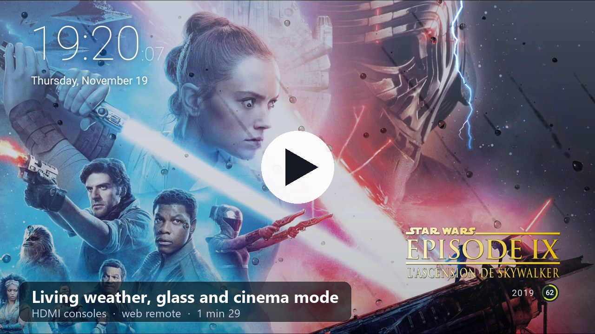
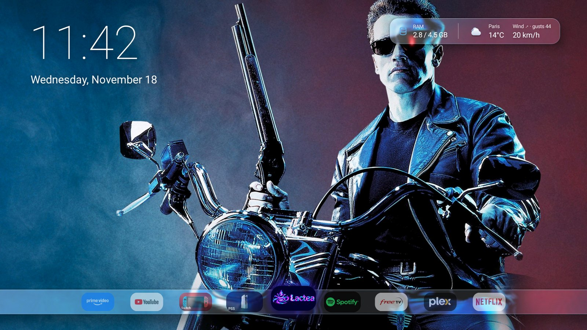
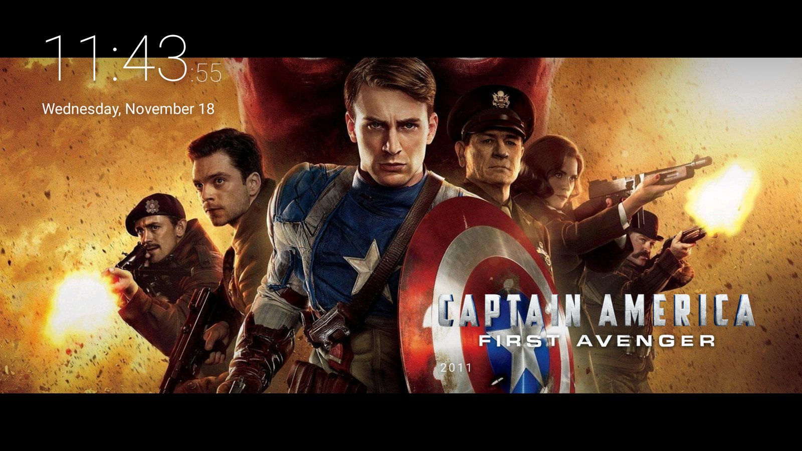
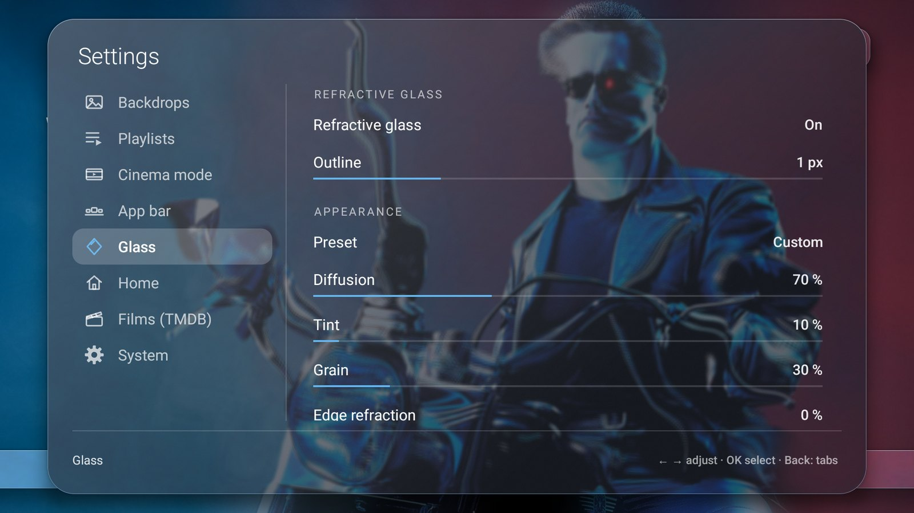
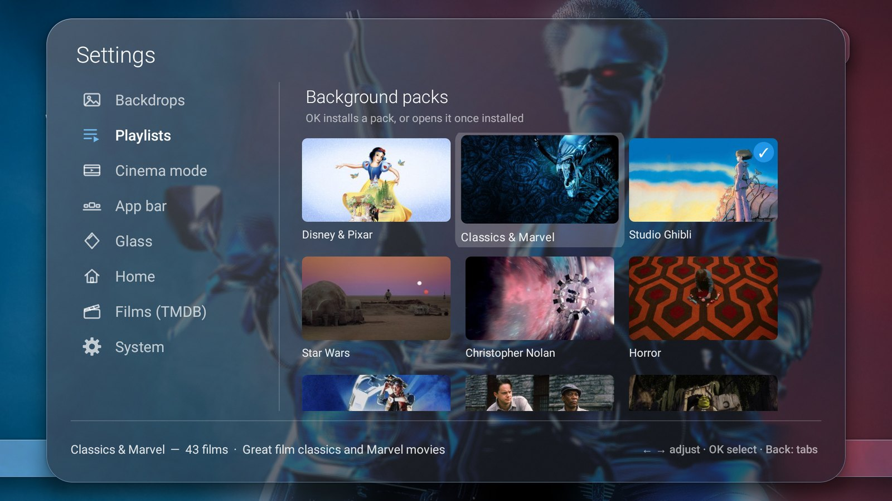

  

  <a href="../README.md"> English</a>
  /
  <a href="README.de.md"> Deutsch</a>
  /
  <a href="README.it.md"> Italiano</a>
  /
  <a href="README.es.md"> Español</a>
  /
  <a href="README.sv.md"> Svenska</a>
  /
  <a href="README.fr.md"> Français</a>

# Proscenium

Proscenium sustituye la pantalla de inicio de tu TV Android por una sala de cine: grandes imágenes
de películas a pantalla completa que se mueven suavemente, una barra de cristal para tus apps, la
hora, el tiempo y un modo cine que toma el relevo cuando el mando se queda quieto.

Funciona en TV y cajas Android TV / Google TV (Android 7.1 o más reciente) y se maneja por completo
con el mando a distancia.

  
   ▶ Vídeo de demostración (55 s)

  
  
   
  
  
   Inicio · Modo cine · Ajustes y cristal · Packs de fondos

## Instalación

1. Descarga `Proscenium.apk` en la página [Releases](https://github.com/Karlos-fr/proscenium/releases)
   e instálalo en la TV (con una memoria USB y un gestor de archivos, o con una app como
   «Send files to TV»).
2. Abre Proscenium. La primera vez, Android puede pedirte que elijas la pantalla de inicio:
   elige Proscenium.
3. En las TV con Google TV (Sony, TCL, Chromecast…), el botón Inicio del mando siempre lleva al
   inicio de Google. Para que abra Proscenium, activa el servicio previsto para ello:
   **Ajustes → Sistema → Servicio del botón Inicio**, que abre la página de accesibilidad de Android.

Los ajustes se abren seleccionando el banner de la hora y el tiempo (flecha hacia arriba, luego OK),
o desde el menú de una app de la barra.

La primera vez, una pantalla de **Primeros pasos** ayuda a elegir el idioma, la ciudad del
tiempo, un pack de fondos y el servicio del botón de inicio. Sigue disponible después en
**Ajustes → Sistema → Primeros pasos**.

### Actualizaciones

Proscenium comprueba una vez al día si hay una nueva versión en GitHub y te avisa. Para instalarla,
abre **Ajustes → Sistema → Actualización** y pulsa OK: la nueva versión se descarga y Android te pide
que confirmes. Tus ajustes se conservan. La primera vez, Android te pide que permitas a Proscenium
instalar aplicaciones.

También puedes seguir las actualizaciones con [Obtainium](https://github.com/ImranR98/Obtainium): añade `https://github.com/Karlos-fr/proscenium` como fuente.

> **¿Vienes de la versión 1.0?** La versión 1.1 está firmada con una nueva clave y no se puede instalar
> encima de la 1.0: desinstala Proscenium y luego instala la 1.1. Los ajustes y las listas empiezan de
> cero (los packs se reinstalan con un clic). Solo ocurre una vez: las versiones siguientes se
> instalarán directamente encima de la 1.1.

## La pantalla de inicio

- **Fondos de películas a pantalla completa**, que cambian cada pocos segundos, con una transición a
  elegir (fundido, deslizamiento…).
- **Efecto Ken Burns**: la imagen hace zoom y se desplaza lentamente, como en un documental. Amplitud
  y duración ajustables.
- **Colores que siguen a la imagen**: el color dominante de cada fondo tiñe el cristal, la luz y los
  iconos. O un color fijo, si lo prefieres.
- **Legibilidad**: un ligero oscurecimiento aparece solo donde el texto sería difícil de leer.
- **Profundidad**: el fondo se desplaza un poco cuando se mueve la selección, y llega borroso y luego
  nítido cuando vuelves a la pantalla de inicio.
- **La hora y la fecha**, en grande, con cifras que ruedan. Formato de 24 h o 12 h, tamaño ajustable.
- **Un banner de información**: memoria usada, procesador y el tiempo de tu ciudad con un icono
  animado (sol que gira, lluvia, nieve, tormenta, niebla), la temperatura, el viento, su dirección y
  sus rachas. Cada elemento se puede ocultar.

## El tiempo vivo

El tiempo puede cobrar vida sobre la imagen, como en una escena de película:

- **Sol**: rayos de luz atraviesan las zonas claras de la imagen, con un halo cálido y polvo que
  brilla en la luz. En una imagen oscura, suaves haces salen del sol. El sol se desplaza despacio y
  de vez en cuando las nubes atenúan la luz.
- **Lluvia**: las gotas caen sobre la pantalla como sobre un cristal, crecen y luego se deslizan
  dejando un rastro mojado. El viento de tu ciudad las empuja de lado, con ráfagas repentinas.
- **Rayos**: rayos ramificados de verdad que iluminan la imagen.
- **Nieve**: caen copos, y los que tocan la pantalla se funden en gotas.
- **Niebla**: bancos de bruma que se desplazan, se arremolinan, se espesan y se disipan.

**Tiempo real** muestra el tiempo de tu ciudad (una tormenta trae lluvia y rayos, la llovizna trae
lluvia y niebla…). **Personalizado** combina las capas que quieras, con el viento que elijas.
**Aleatorio** sortea una mezcla nueva de vez en cuando, y **Según el fondo** elige una para cada
fondo según los géneros de la película, su sinopsis y la luz de la imagen (nieve para una película
de invierno, niebla para una historia de fantasmas, sol para un western…). En todos los modos las
capas se suman y el tiempo pasa suavemente de un fondo a otro. Cada
tiempo tiene su página en **Ajustes → Inicio → Ajustes del tiempo**: preajustes, cada ajuste
visible en directo sobre la imagen, valores aleatorios y vuelta a los ajustes originales.

## La barra de apps

- **Un carrusel de tus apps**, con sus banners de TV. Elige cuáles aparecen y en qué orden.
- **La app seleccionada** crece, se inclina ligeramente y recibe un reflejo y una luz de color a su
  alrededor. Esa luz toma el color de su logotipo y ondula suavemente por todo su contorno.
- **Cristal realista**: la barra refracta la imagen que pasa por detrás, con preajustes (Claro,
  Sutil, Escarchado, Fuerte) y efectos de agua en calma, líquido o lluvia.
- **Accesos directos a las entradas HDMI**: una consola, un reproductor Blu-ray o una caja conectados
  a la TV tienen su propio mosaico en la barra, con un nombre y un icono entre 24 consolas
  (PlayStation, Xbox, Nintendo, Sega…). OK pasa directamente a la entrada correcta.
- **Todo se puede ajustar**: número de apps visibles, tamaño y separación de los mosaicos, banda a
  todo el ancho o barra flotante, velocidad de desplazamiento, vuelta al principio tras la última app.

## El modo cine y el salvapantallas

Cuando el mando se queda quieto un rato, la pantalla de inicio pasa al **modo cine**: la interfaz
se desvanece, unas bandas negras recortan la imagen en formato cine (2:1 o Scope 2,39:1) y aparece
el título de la película, con su logotipo oficial cuando existe y su año. El tiempo de espera, las
bandas, el título y el banner son ajustables.

La tarjeta del título también puede mostrar la **ficha de la película**: año, duración y géneros,
la nota de TMDB (estrellas, un anillo en porcentaje o una nota sobre 10) y una sinopsis corta o
completa que se desplaza despacio. Los packs traen estas fichas en seis idiomas.

Proscenium también puede servir de **salvapantallas de Android**: elígelo en los ajustes de Android,
en el apartado Salvapantallas.

En Google TV, Android solo muestra los salvapantallas de Google. Elige Proscenium una vez desde
un ordenador, con [adb](https://developer.android.com/tools/adb) conectado al televisor:
`adb shell settings put secure screensaver_components fr.proscenium.launcher/.CinemaDream`. **Ajustes → Modo cine → Salvapantallas** lo activa o lo desactiva.

**Ajustes → Modo cine → Mantener la pantalla encendida** impide que Android inicie su salvapantallas
o se suspenda mientras se muestra Proscenium: el modo cine sigue entonces sin fin (consume más, y
algunas TV entran igualmente en reposo al cabo de unas horas).

## Tus fondos: listas y packs

Las imágenes de la pantalla de inicio vienen de las **fotos de Bing del día** o de **tus listas** de
películas.

- **Packs de fondos**: listas temáticas ya preparadas (20 packs: Star Wars,
  Studio Ghibli, Christopher Nolan, terror, los 80, James Bond, wésterns…), que se instalan con un clic desde **Ajustes → Listas → Explorar los packs**.
  No requieren ninguna clave de TMDB. Los títulos y logotipos están en tu idioma cuando existen.
- **Tus propias listas**: busca una película por su título, con el teclado o con la voz, o importa de
  una vez las películas populares o en tendencia. Para cada película, elige el fondo o los fondos que
  te gusten y el logotipo que se mostrará.
- **Tendencias del momento**: una lista que se actualiza sola cada día con las películas del
  momento.
- Varias listas pueden estar activas a la vez: sus fondos se mezclan.
- **Actualizaciones de packs**: cuando se añaden películas a un pack, muestra "actualización
  disponible" y **Actualizar los packs instalados** descarga las nuevas películas. Cualquiera puede
  proponer un pack: ver [packs/README.md](../packs/README.md).

Las imágenes vienen de [The Movie Database (TMDB)](https://www.themoviedb.org). Puedes mostrar solo
los fondos sin texto y en Full HD.

## La clave de TMDB

Los packs funcionan sin clave. Para buscar películas tú mismo, necesitas una clave de API de TMDB,
gratuita: crea una cuenta en [themoviedb.org](https://www.themoviedb.org/signup) y solicita una
clave en los ajustes de tu cuenta, en el apartado API.

No hace falta escribirla con el mando: **Ajustes → Películas (TMDB) → Introducir la clave desde el
móvil** muestra un código QR. Escanéalo con tu móvil (conectado a la misma red que la TV) y pega la
clave en la página que se abre: la TV la comprueba y la guarda.

## El mando web

**Ajustes → Sistema → Mando web** lleva todos los ajustes a tu móvil o a tu ordenador: actívalo y
escanea el código QR que muestra la TV (el móvil debe estar en la misma wifi). La página tiene las
mismas pestañas que el panel de ajustes (salvo el cristal), funciona en el móvil y en el navegador
de un ordenador, y muestra la película en pantalla con un botón para el siguiente fondo. Desde ella
eliges las listas que se muestran, instalas o quitas packs, ordenas las apps de la barra, escribes
la ciudad del tiempo o la clave de TMDB, y ajustas cada tiempo mientras se ve en directo en la TV.
La página se actualiza sola cuando un ajuste cambia en la TV. La dirección no cambia:
**http://proscenium.local:8770** en un iPhone, un Mac o un ordenador, o la dirección de la TV que
aparece bajo el código QR; guárdala en favoritos o añádela a la pantalla de inicio. El nombre se
puede cambiar, y el navegador puede pedir una contraseña (recomendada si otras personas usan tu
wifi). Solo los aparatos de la red de casa pueden llegar a la página. Sin **Dirección fija**, la
dirección es secreta y nueva cada vez que se inicia Proscenium.

## Y además

- **Seis idiomas**: francés, inglés, alemán, italiano, español y sueco. Por defecto, el idioma de la
  TV.
- **Sonidos de interfaz** discretos, con volumen ajustable.
- **Modo ahorro**: desactiva de golpe los efectos más exigentes, para las cajas pequeñas.
- **Copia de seguridad y restauración** de todos los ajustes.

## Preguntas frecuentes

**¿Funciona en Fire TV?** Probablemente como aplicación, pero no como pantalla de inicio: Amazon
impide sustituir la suya, así que el botón de inicio siempre vuelve a la de Amazon. No está probado.
Los Fire TV más recientes con Vega OS no pueden instalar aplicaciones Android.

**¿Por qué el botón de inicio sigue abriendo la pantalla de Google?** En Google TV, ese botón lo
gestiona Google. Activa el servicio previsto (**Ajustes → Sistema → Servicio del botón Inicio**, y
luego Proscenium en la página de accesibilidad de Android): el botón de inicio abrirá Proscenium.

**¿Por qué una clave de TMDB?** Solo sirve para buscar películas por tu cuenta. Los packs, las fotos
de Bing y el tiempo funcionan sin ella. TMDB da claves gratuitas a proyectos personales y cada usuario
tiene la suya: Proscenium no comparte una misma clave entre todos.

**¿Cuántos datos consume?** Unos 0,5 MB por película (un fondo de unos 400 KB y su logo), descargados
una sola vez y guardados en el televisor: unos 20 MB para un pack de 40 películas. Después, solo usan
la red las películas nuevas, la foto de Bing del día (si la eliges), el tiempo (pocos KB) y una
comprobación diaria de actualizaciones.

## Créditos

- Películas, fondos y logotipos: [The Movie Database (TMDB)](https://www.themoviedb.org). Este
  producto utiliza la API de TMDB pero no está respaldado ni certificado por TMDB. Las imágenes
  siguen siendo propiedad de sus respectivos titulares de derechos.
- Fotos del día: Bing. Tiempo: [Open-Meteo](https://open-meteo.com).
- Código publicado con [licencia MIT](../LICENSE).
