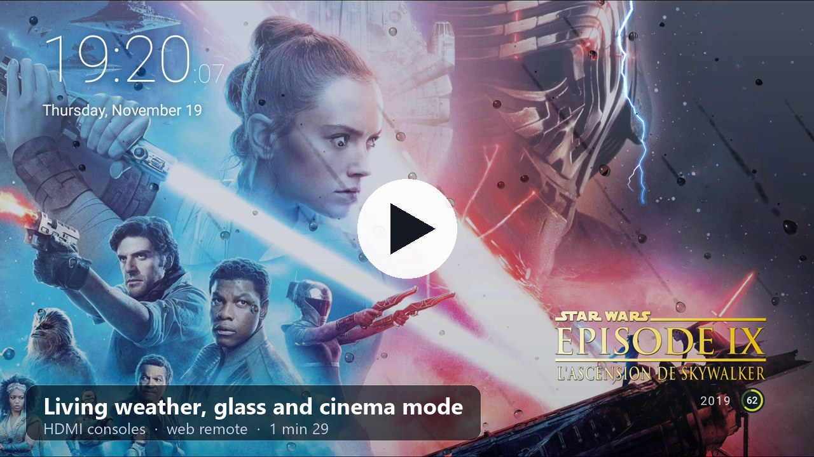
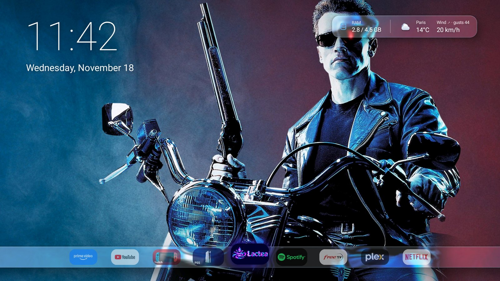
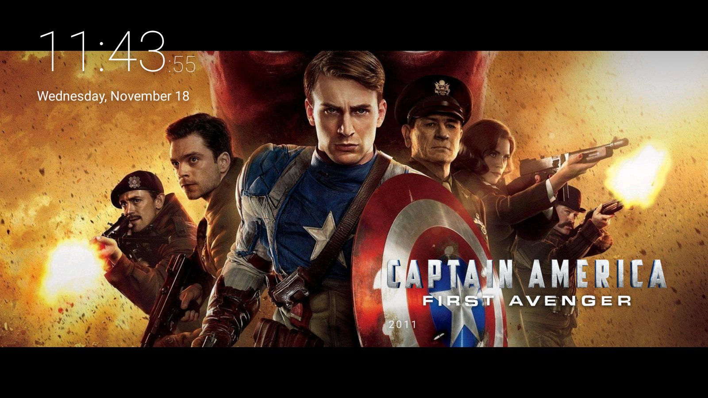
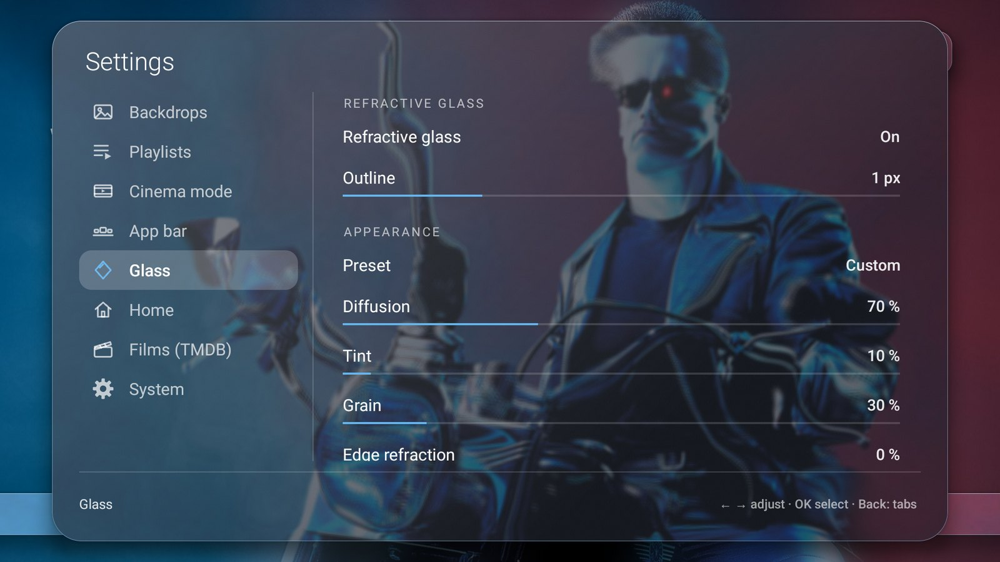
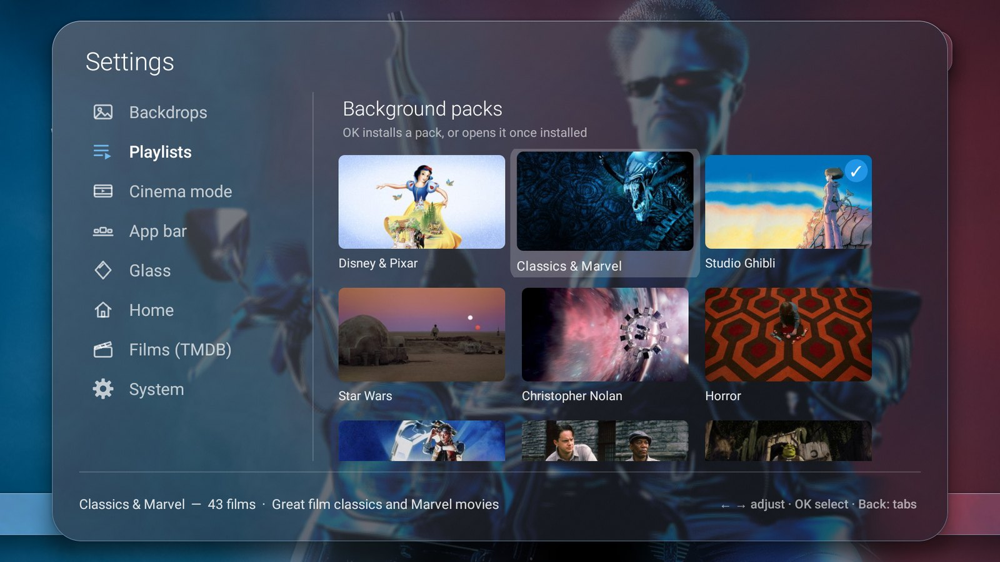

  

  <a href="../README.md"> English</a>
  /
  <a href="README.de.md"> Deutsch</a>
  /
  <a href="README.it.md"> Italiano</a>
  /
  <a href="README.es.md"> Español</a>
  /
  <a href="README.sv.md"> Svenska</a>
  /
  <a href="README.fr.md"> Français</a>

# Proscenium

Proscenium remplace l'écran d'accueil de votre TV Android par une salle de cinéma : de grandes
images de films en plein écran qui bougent doucement, une barre d'applications en verre, l'heure,
la météo, et un mode cinéma qui prend le relais quand la télécommande reste posée.

Il fonctionne sur les TV et boîtiers Android TV / Google TV (Android 7.1 ou plus récent) et se pilote
entièrement à la télécommande.

  
   ▶ Vidéo de démonstration (55 s)

  
  
   
  
  
   Accueil · Mode cinéma · Réglages et verre réfractant · Packs de fonds

## Installation

1. Téléchargez `Proscenium.apk` sur la page [Releases](https://github.com/Karlos-fr/proscenium/releases)
   et installez-le sur la TV (par une clé USB et un gestionnaire de fichiers, ou une appli comme
   « Send files to TV »).
2. Ouvrez Proscenium. La première fois, Android peut vous demander de choisir l'écran d'accueil :
   choisissez Proscenium.
3. Sur les TV Google TV (Sony, TCL, Chromecast…), le bouton Accueil de la télécommande ramène
   toujours l'accueil Google. Pour qu'il ouvre Proscenium, activez le service prévu pour ça :
   **Réglages → Système → Service du bouton Accueil**, qui ouvre la page d'accessibilité d'Android.

Les réglages s'ouvrent en sélectionnant le bandeau de l'heure et de la météo (flèche vers le haut,
puis OK), ou depuis le menu d'une appli de la barre.

La première fois, un écran **Premiers pas** aide à choisir la langue, la ville de la météo, un
pack de fonds et le service du bouton Accueil. Il reste disponible ensuite dans
**Réglages → Système → Premiers pas**.

### Mises à jour

Proscenium vérifie une fois par jour s'il existe une nouvelle version sur GitHub et vous prévient.
Pour l'installer, ouvrez **Réglages → Système → Mise à jour** et appuyez sur OK : la nouvelle version
est téléchargée et Android vous demande de confirmer. Vos réglages sont conservés. La première fois,
Android vous demande d'autoriser Proscenium à installer des applis.

Vous pouvez aussi suivre les mises à jour avec [Obtainium](https://github.com/ImranR98/Obtainium) : ajoutez `https://github.com/Karlos-fr/proscenium` comme source.

> **Vous venez de la version 1.0 ?** La version 1.1 est signée avec une nouvelle clé : elle ne peut pas
> s'installer par-dessus la 1.0. Désinstallez Proscenium, puis installez la 1.1. Les réglages et les
> playlists repartent de zéro (les packs se réinstallent en un clic). Cela n'arrive qu'une fois : les
> versions suivantes s'installeront directement par-dessus la 1.1.

## L'accueil

- **Fonds de films en plein écran**, renouvelés toutes les quelques secondes, avec une transition au
  choix (fondu, glissement…).
- **Effet Ken Burns** : l'image zoome et dérive lentement, comme dans un documentaire. Ampleur et
  durée réglables.
- **Couleurs qui suivent l'image** : la couleur dominante de chaque fond teinte le verre, la lumière
  et les icônes. Ou une couleur fixe, si vous préférez.
- **Lisibilité** : un léger assombrissement n'apparaît que là où le texte serait difficile à lire.
- **Profondeur** : le fond se décale un peu quand la sélection bouge, et arrive flou puis net quand
  on revient sur l'accueil.
- **L'heure et la date**, en grand, avec des chiffres qui roulent. Format 24 h ou 12 h, taille
  réglable.
- **Un bandeau d'informations** : mémoire utilisée, processeur, et la météo de votre ville avec une
  icône animée (soleil qui tourne, pluie, neige, orage, brouillard), la température, le vent, sa
  direction et ses rafales. Chaque élément peut être masqué.

## La météo vivante

La météo peut s'animer sur l'image, comme dans une scène de film :

- **Soleil** : des rayons de lumière traversent les zones claires de l'image, avec un halo chaud et
  des poussières qui scintillent dans la lumière. Sur une image sombre, de doux faisceaux partent du
  soleil. Le soleil glisse lentement et des nuages baissent la lumière de temps en temps.
- **Pluie** : des gouttes se posent sur l'écran comme sur une vitre, grossissent, puis glissent en
  laissant une traînée mouillée. Le vent de votre ville les pousse de côté, avec des bourrasques.
- **Éclairs** : de vrais éclairs ramifiés qui illuminent l'image.
- **Neige** : des flocons tombent, et ceux qui touchent l'écran fondent en gouttes.
- **Brouillard** : des nappes de brume qui dérivent, tourbillonnent, s'épaississent et se dissipent.

**Météo réelle** montre le temps qu'il fait dans votre ville (un orage amène pluie et éclairs, la
bruine amène pluie et brouillard…). **Personnalisée** permet de cumuler les couches voulues, avec le
vent de votre choix.
**Aléatoire** tire un nouveau mélange de temps en temps, et **Selon le fond** en choisit un pour
chaque fond d'après les genres du film, son résumé et la lumière de l'image (de la neige pour un
film d'hiver, de la brume pour une histoire de fantômes, du soleil pour un western…). Dans tous les
modes, les couches se cumulent et la météo passe en douceur d'un fond à l'autre. Chaque météo a sa page dans **Réglages → Accueil → Réglages de la météo** :
préréglages, chaque réglage visible en direct sur l'image, valeurs aléatoires et retour aux réglages
d'origine.

## La barre d'applications

- **Un carrousel de vos applis**, avec leurs bannières TV. Choisissez lesquelles y figurent et dans
  quel ordre.
- **L'appli sélectionnée** grandit, s'incline légèrement, reçoit un reflet et une lumière colorée
  autour d'elle. Cette lumière prend la couleur de son logo et ondule doucement tout autour.
- **Verre réaliste** : la barre réfracte l'image qui passe derrière elle, avec des préréglages
  (Clair, Subtil, Givré, Fort) et des effets d'eau calme, de liquide ou de pluie.
- **Raccourcis vers les entrées HDMI** : une console, un lecteur Blu-ray ou une box branchés sur la
  TV ont leur propre tuile dans la barre, avec un nom et une icône parmi 24 consoles (PlayStation,
  Xbox, Nintendo, Sega…). OK passe directement sur la bonne entrée.
- **Tout se règle** : nombre d'applis visibles, taille et espacement des tuiles, bande pleine
  largeur ou barre flottante, vitesse de défilement, retour au début après la dernière appli.

## Le mode cinéma et l'économiseur d'écran

Quand la télécommande reste posée un moment, l'accueil passe en **mode cinéma** : l'interface
s'efface, des bandes noires recadrent l'image en format cinéma (2:1 ou Scope 2,39:1), et le titre du
film s'affiche, avec son logo officiel quand il existe et son année. Le délai, les bandes, le titre
et le bandeau sont réglables.

La carte titre peut aussi afficher la **fiche du film** : année, durée et genres, la note TMDB
(étoiles, anneau en pourcentage ou note sur 10), et un résumé court ou complet qui défile doucement.
Les packs apportent ces fiches en six langues.

Proscenium peut aussi servir **d'économiseur d'écran Android** : choisissez-le dans les paramètres
d'Android, rubrique Économiseur d'écran.

Sur Google TV, Android ne liste que les économiseurs de Google. Choisissez Proscenium une fois
depuis un ordinateur, avec [adb](https://developer.android.com/tools/adb) connecté à la TV :
`adb shell settings put secure screensaver_components fr.proscenium.launcher/.CinemaDream`. **Réglages → Mode cinéma → Économiseur d'écran** l'active ou le désactive.

## Vos fonds : playlists et packs

Les images de l'accueil viennent soit des **photos Bing du jour**, soit de **vos playlists** de films.

- **Packs de fonds** : des playlists thématiques toutes prêtes (20 packs : Star Wars,
  Studio Ghibli, Christopher Nolan, horreur, années 80, James Bond, westerns…), à installer en un clic depuis **Réglages → Playlists → Parcourir les packs**.
  Elles ne demandent aucune clé TMDB. Titres et logos sont dans votre langue quand ils existent.
- **Vos propres playlists** : cherchez un film par son titre, au clavier ou à la voix, ou importez
  d'un coup les films populaires ou en tendance. Pour chaque film, choisissez le ou les fonds qui
  vous plaisent et le logo à afficher.
- **Tendances du moment** : une playlist qui se tient à jour toute seule chaque jour avec les films
  en vogue.
- Plusieurs playlists peuvent être actives en même temps : leurs fonds se mélangent.
- **Mises à jour des packs** : quand des films sont ajoutés à un pack, il affiche « mise à jour
  disponible » et **Mettre à jour les packs installés** télécharge les nouveaux films. Tout le monde
  peut proposer un pack : voir [packs/README.md](../packs/README.md).

Les images viennent de [The Movie Database (TMDB)](https://www.themoviedb.org). Vous pouvez
n'afficher que les fonds sans texte et en Full HD.

## La clé TMDB

Les packs fonctionnent sans clé. Pour chercher des films vous-même, il faut une clé d'API TMDB,
gratuite : créez un compte sur [themoviedb.org](https://www.themoviedb.org/signup), puis demandez une
clé dans les paramètres de votre compte, rubrique API.

Pas besoin de la taper à la télécommande : **Réglages → Films (TMDB) → Saisir la clé depuis le
téléphone** affiche un QR code. Scannez-le avec votre téléphone (connecté au même réseau que la TV),
collez la clé dans la page qui s'ouvre : la TV la vérifie et l'enregistre.

## La télécommande web

**Réglages → Système → Télécommande web** met tous les réglages sur votre téléphone ou votre
ordinateur : activez-la, puis scannez le QR code affiché par la TV (le téléphone doit être sur le
même Wi-Fi). La page reprend les onglets du panneau de réglages (sauf le verre), fonctionne sur un
téléphone comme dans le navigateur d'un ordinateur, et montre le film à l'écran avec un bouton pour
passer au fond suivant. On y choisit les playlists affichées, on installe ou supprime des packs, on
range les applis de la barre, on saisit la ville de la météo ou la clé TMDB, et on règle chaque
météo pendant qu'elle s'affiche en direct sur la TV. La page se met à jour toute seule quand un
réglage change sur la TV. L'adresse reste la même : **http://proscenium.local:8770** sur un iPhone, un Mac ou un ordinateur,
ou l'adresse de la TV affichée sous le QR code ; gardez-la en favori ou ajoutez-la à l'écran
d'accueil. Le nom se change, et un mot de passe peut être demandé par le navigateur (conseillé si
d'autres personnes utilisent votre Wi-Fi). Seuls les appareils du réseau de la maison peuvent
atteindre la page. Sans **Adresse fixe**, l'adresse est secrète et neuve à chaque démarrage de
Proscenium.

## Et aussi

- **Six langues** : français, anglais, allemand, italien, espagnol et suédois. Par défaut, la langue
  de la TV.
- **Sons d'interface** discrets, volume réglable.
- **Mode économie** : coupe d'un coup les effets les plus gourmands, pour les petits boîtiers.
- **Sauvegarde et restauration** de tous les réglages.

## FAQ

**Ça marche sur Fire TV ?** Probablement comme une appli, mais pas comme écran d'accueil : Amazon
empêche de remplacer le sien, donc le bouton Accueil ramène toujours l'accueil d'Amazon. Ce n'est pas
testé. Les Fire TV les plus récents, sous Vega OS, ne peuvent pas du tout installer d'applis Android.

**Pourquoi le bouton Accueil ouvre-t-il encore l'accueil Google ?** Sur Google TV, ce bouton est géré
par Google. Activez le service prévu pour ça (**Réglages → Système → Service du bouton Accueil**,
puis Proscenium dans la page d'accessibilité d'Android) : le bouton Accueil ouvre alors Proscenium.

**Pourquoi une clé TMDB ?** Elle ne sert qu'à chercher des films vous-même. Les packs, les photos
Bing et la météo s'en passent. TMDB donne gratuitement des clés aux projets personnels, et chaque
utilisateur a la sienne : Proscenium ne partage pas une même clé entre tout le monde.

**Combien de données ça consomme ?** Environ 0,5 Mo par film (un fond d'environ 400 Ko et son logo),
téléchargés une seule fois puis gardés sur la TV : environ 20 Mo pour un pack de 40 films. Ensuite,
seuls les nouveaux films, la photo Bing du jour (si vous l'avez choisie), la météo (quelques Ko) et
une vérification quotidienne des mises à jour passent par le réseau.

## Crédits

- Films, fonds et logos : [The Movie Database (TMDB)](https://www.themoviedb.org). Ce produit utilise
  l'API TMDB mais n'est ni approuvé ni certifié par TMDB. Les images restent la propriété de leurs
  ayants droit.
- Photos du jour : Bing. Météo : [Open-Meteo](https://open-meteo.com).
- Code publié sous [licence MIT](../LICENSE).
