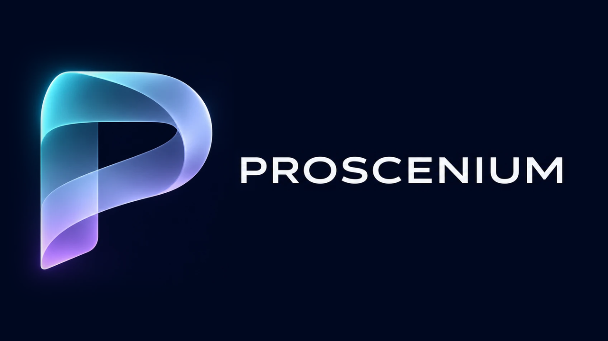
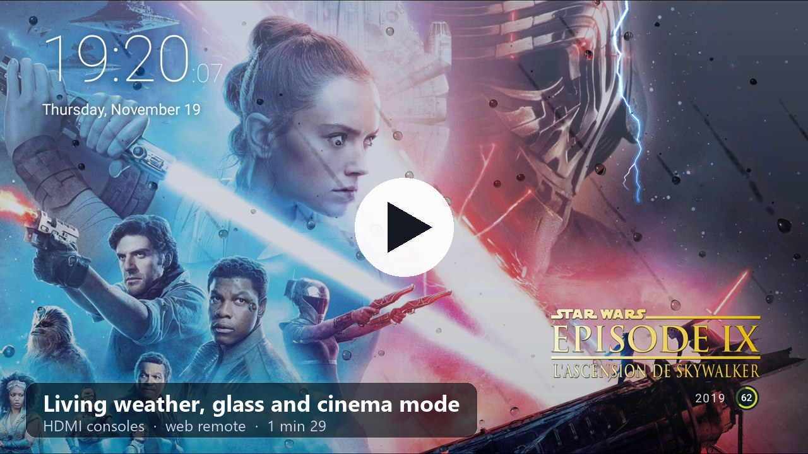
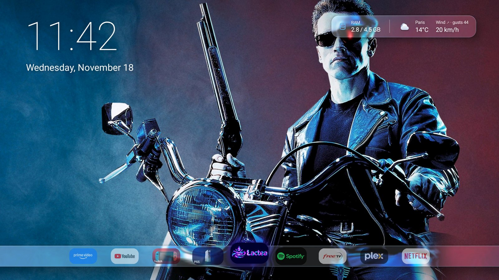
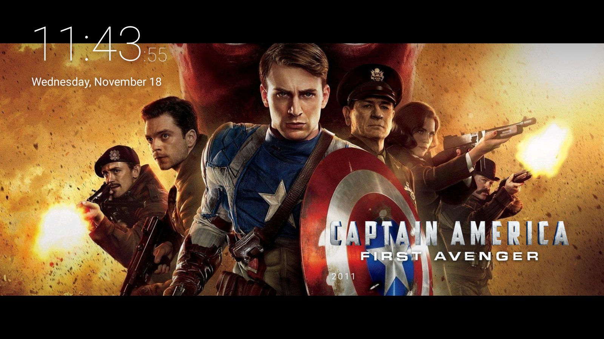
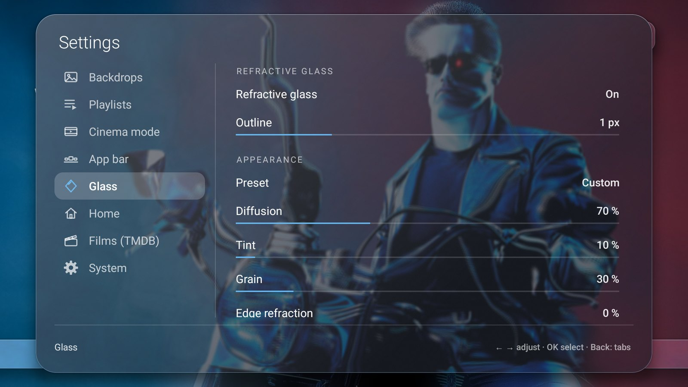
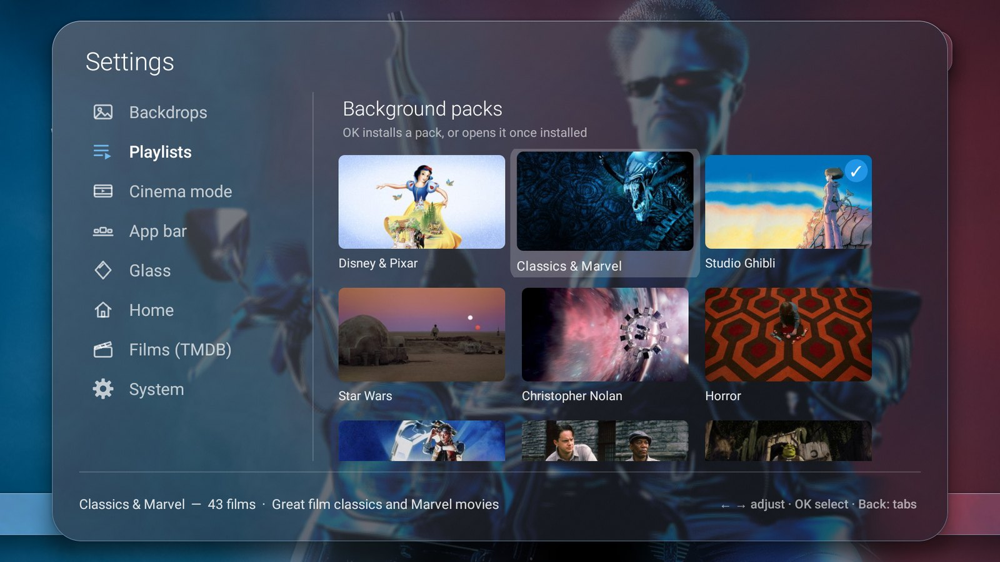

  

  <a href="../README.md"> English</a>
  /
  <a href="README.de.md"> Deutsch</a>
  /
  <a href="README.it.md"> Italiano</a>
  /
  <a href="README.es.md"> Español</a>
  /
  <a href="README.sv.md"> Svenska</a>
  /
  <a href="README.fr.md"> Français</a>

# Proscenium

Proscenium ersätter startskärmen på din Android-TV med en biosalong: stora filmbilder i helskärm som
rör sig mjukt, ett glasfält för dina appar, klockan, vädret och ett bioläge som tar över när
fjärrkontrollen får ligga still.

Det fungerar på Android TV- och Google TV-apparater och -boxar (Android 7.1 eller senare) och styrs
helt med fjärrkontrollen.

  
   ▶ Demovideo (55 s)

  
  
   
  
  
   Startskärm · Bioläge · Inställningar och glas · Bakgrundspaket

## Installation

1. Ladda ner `Proscenium.apk` från sidan [Releases](https://github.com/Karlos-fr/proscenium/releases)
   och installera den på TV:n (via ett USB-minne och en filhanterare, eller med en app som
   ”Send files to TV”).
2. Öppna Proscenium. Första gången kan Android be dig välja startskärm: välj Proscenium.
3. På Google TV-apparater (Sony, TCL, Chromecast …) tar hem-knappen på fjärrkontrollen alltid dig
   till Googles startskärm. För att den ska öppna Proscenium aktiverar du tjänsten som finns för
   det: **Inställningar → System → Hem-knappstjänst**, som öppnar Androids tillgänglighetssida.

Inställningarna öppnar du genom att markera fältet med klockan och vädret (pil uppåt, sedan OK),
eller från menyn för en app i fältet.

Första gången hjälper skärmen **Kom igång** dig att välja språk, ort för vädret, ett
bakgrundspaket och hemknappstjänsten. Den finns sedan kvar under
**Inställningar → System → Kom igång**.

### Uppdateringar

Proscenium söker en gång om dagen efter en ny version på GitHub och säger till. Installera den via
**Inställningar → System → Uppdatering** och tryck på OK: den nya versionen laddas ner och Android ber
dig bekräfta. Dina inställningar behålls. Första gången ber Android dig tillåta att Proscenium
installerar appar.

Du kan också följa uppdateringarna med [Obtainium](https://github.com/ImranR98/Obtainium): lägg till `https://github.com/Karlos-fr/proscenium` som källa.

> **Har du version 1.0?** Version 1.1 är signerad med en ny nyckel och kan inte installeras ovanpå
> 1.0: avinstallera Proscenium och installera sedan 1.1. Inställningar och spellistor börjar om från
> början (paketen installeras om med ett klick). Det behövs bara en gång: senare versioner installeras
> direkt ovanpå 1.1.

## Startskärmen

- **Filmbakgrunder i helskärm** som byts ut med några sekunders mellanrum, med en övergång som du
  väljer (toning, glidning …).
- **Ken Burns-effekt**: bilden zoomar och glider långsamt, som i en dokumentär. Omfång och längd kan
  justeras.
- **Färger som följer bilden**: den dominerande färgen i varje bakgrund färgar glaset, ljuset och
  ikonerna. Eller en fast färg, om du föredrar det.
- **Läsbarhet**: en lätt mörkläggning visas bara där texten annars vore svår att läsa.
- **Djup**: bakgrunden förskjuts lite när markeringen flyttas, och kommer först suddig, sedan
  skarp när du återvänder till startskärmen.
- **Klockan och datumet**, stort, med siffror som rullar. 24- eller 12-timmarsformat, justerbar
  storlek.
- **Ett informationsfält**: använt minne, processor och vädret för din stad med en animerad ikon
  (roterande sol, regn, snö, åska, dimma), temperatur, vind, vindriktning och byar. Varje element
  kan döljas.

## Levande väder

Vädret kan få liv i bilden, som i en filmscen:

- **Sol**: ljusstrålar strömmar genom bildens ljusa delar, med en varm gloria och damm som glittrar
  i ljuset. På en mörk bild tar mjuka strålar från solen över. Solen rör sig långsamt och moln
  dämpar ljuset då och då.
- **Regn**: droppar landar på skärmen som på en fönsterruta, växer och glider sedan ner med ett vått
  spår. Vinden i din stad blåser dem åt sidan, med plötsliga byar.
- **Blixtar**: riktiga förgrenade blixtar som lyser upp bilden.
- **Snö**: flingor faller, och de som når skärmen smälter till droppar.
- **Dimma**: dimbankar som driver, virvlar, tätnar och lättar.

**Verkligt väder** visar vädret i din stad (ett åskväder ger regn och blixtar, duggregn ger regn
och dimma…). **Anpassat** kombinerar de lager du vill, med den vind du väljer.
**Slumpmässig** lottar en ny blandning då och då, och **Efter bakgrunden** väljer en för varje
bakgrund efter filmens genrer, handling och bildens ljus (snö för en vinterfilm, dimma för en
spökhistoria, sol för en western…). I alla lägen läggs lagren ihop och vädret går mjukt över från
en bakgrund till nästa. Varje väder har sin
egen sida under **Inställningar → Hem → Väderinställningar**: förinställningar, varje inställning
syns direkt i bilden, slumpvärden och återgång till ursprungsinställningarna.

## Appfältet

- **En karusell med dina appar**, med deras TV-banners. Välj vilka som ska visas och i vilken
  ordning.
- **Den markerade appen** växer, lutar lätt, får en reflektion och ett färgat ljus runt sig. Ljuset
  tar färgen från appens logotyp och böljar mjukt runt hela appen.
- **Realistiskt glas**: fältet bryter bilden som passerar bakom det, med förinställningar (Klart,
  Subtilt, Frostat, Starkt) och effekter som stilla vatten, vätska eller regn.
- **Genvägar till HDMI-ingångar**: en spelkonsol, en Blu-ray-spelare eller en box som är ansluten
  till TV:n får en egen ruta i fältet, med ett namn och en ikon bland 24 konsoler (PlayStation, Xbox,
  Nintendo, Sega …). OK går direkt till rätt ingång.
- **Allt går att justera**: antal synliga appar, rutornas storlek och avstånd, band i full bredd
  eller flytande fält, rullningshastighet, återgång till början efter sista appen.

## Bioläget och skärmsläckaren

När fjärrkontrollen får ligga still en stund går startskärmen över i **bioläge**: gränssnittet
tonas bort, svarta fält beskär bilden till biografformat (2:1 eller Scope 2,39:1) och filmens titel
visas, med sin officiella logotyp när det finns en, och utgivningsår. Väntetid, fält, titel och
banner kan justeras.

Titelkortet kan också visa **uppgifter om filmen**: år, speltid och genrer, TMDB-betyget (stjärnor,
en procentring eller ett betyg av 10) och en kort eller fullständig handling som rullar långsamt.
Paketen har dessa uppgifter på sex språk.

Proscenium kan också fungera som **Androids skärmsläckare**: välj den i Androids inställningar,
under Skärmsläckare.

På Google TV visar Android bara Googles egna skärmsläckare. Välj Proscenium en gång från en
dator, med [adb](https://developer.android.com/tools/adb) anslutet till tv:n:
`adb shell settings put secure screensaver_components fr.proscenium.launcher/.CinemaDream`. **Inställningar → Bioläge → Skärmsläckare** slår på eller av den.

**Inställningar → Bioläge → Håll skärmen på** hindrar Android från att starta sin skärmsläckare eller
gå i viloläge medan Proscenium visas: bioläget fortsätter då utan slut (det drar mer ström, och vissa
tv-apparater går ändå i vänteläge efter några timmar).

## Dina bakgrunder: spellistor och paket

Bilderna på startskärmen kommer antingen från **Bings dagliga foton** eller från **dina spellistor**
med filmer.

- **Bakgrundspaket**: färdiga tematiska spellistor (20 paket: Star Wars,
  Studio Ghibli, Christopher Nolan, skräck, 80-talet, James Bond, westernfilmer …) som du installerar med ett klick från
  **Inställningar → Spellistor → Bläddra bland paket**. De kräver ingen TMDB-nyckel. Titlar och logotyper
  visas på ditt språk när de finns.
- **Dina egna spellistor**: sök efter en film på titel, med tangentbordet eller rösten, eller
  importera alla populära eller trendande filmer på en gång. För varje film väljer du den eller de
  bakgrunder du gillar och logotypen som ska visas.
- **Aktuella trender**: en spellista som uppdaterar sig själv varje dag med de filmer som är
  populära just nu.
- Flera spellistor kan vara aktiva samtidigt: deras bakgrunder blandas.
- **Paketuppdateringar**: när filmer läggs till i ett paket visar det "uppdatering finns" och
  **Uppdatera installerade paket** laddar ner de nya filmerna. Vem som helst kan föreslå ett paket:
  se [packs/README.md](../packs/README.md).

Bilderna kommer från [The Movie Database (TMDB)](https://www.themoviedb.org). Du kan välja att bara
visa bakgrunder utan text och i Full HD.

## TMDB-nyckeln

Paketen fungerar utan nyckel. För att söka efter filmer själv behöver du en gratis TMDB-API-nyckel:
skapa ett konto på [themoviedb.org](https://www.themoviedb.org/signup) och begär sedan en nyckel i
kontots inställningar, under API.

Du behöver inte skriva in den med fjärrkontrollen: **Inställningar → Filmer (TMDB) → Ange nyckeln
från telefonen** visar en QR-kod. Skanna den med din telefon (ansluten till samma nätverk som TV:n)
och klistra in nyckeln på sidan som öppnas: TV:n kontrollerar den och sparar den.

## Webbfjärrkontroll

**Inställningar → System → Webbfjärrkontroll** ger dig alla inställningar i mobilen eller datorn:
slå på den och skanna QR-koden som tv:n visar (mobilen måste vara i samma wifi). Sidan har samma
flikar som inställningspanelen (utom glaset), fungerar i mobilen och i en dators webbläsare, och
visar filmen på skärmen med en knapp för nästa bakgrund. Där väljer du vilka spellistor som visas,
installerar eller tar bort paket, ordnar apparna i fältet, skriver in väderstaden eller
TMDB-nyckeln och ställer in varje väder medan det visas direkt på tv:n. Sidan uppdateras av sig
själv när en inställning ändras på tv:n. Adressen ändras inte: **http://proscenium.local:8770**
på en iPhone, en Mac eller en dator, eller tv:ns adress under QR-koden; spara den som bokmärke eller
lägg till den på hemskärmen. Namnet kan ändras, och webbläsaren kan fråga efter ett lösenord
(rekommenderas om andra använder ditt wifi). Bara enheter i hemnätverket når sidan. Utan **Fast
adress** är adressen hemlig och ny varje gång Proscenium startar.

## Och dessutom

- **Sex språk**: franska, engelska, tyska, italienska, spanska och svenska. Som standard TV:ns
  språk.
- **Diskreta gränssnittsljud**, med justerbar volym.
- **Sparläge**: stänger av de mest krävande effekterna med ett enda klick, för små boxar.
- **Säkerhetskopiering och återställning** av alla inställningar.

## Vanliga frågor

**Fungerar det på Fire TV?** Troligen som app, men inte som startskärm: Amazon hindrar att deras
startskärm ersätts, så hemknappen leder alltid tillbaka till Amazon. Det är inte testat. De nyaste
Fire TV-modellerna med Vega OS kan inte installera Android-appar alls.

**Varför öppnar hemknappen fortfarande Googles startskärm?** På Google TV hanteras knappen av Google.
Slå på tjänsten som finns för detta (**Inställningar → System → Hem-knappstjänst**, sedan Proscenium på
Androids tillgänglighetssida): då öppnar hemknappen Proscenium.

**Varför en TMDB-nyckel?** Den behövs bara för att söka filmer själv. Paket, Bing-foton och vädret
fungerar utan. TMDB ger gratis nycklar till personliga projekt och varje användare har sin egen:
Proscenium delar inte en gemensam nyckel.

**Hur mycket data används?** Ungefär 0,5 MB per film (en bakgrund på cirka 400 KB och dess logotyp),
nedladdade en gång och sedan sparade på tv:n: cirka 20 MB för ett paket med 40 filmer. Därefter
använder bara nya filmer, dagens Bing-foto (om du valt det), vädret (några KB) och en daglig
uppdateringskontroll nätet.

## Tack till

- Filmer, bakgrunder och logotyper: [The Movie Database (TMDB)](https://www.themoviedb.org). Den här
  produkten använder TMDB:s API men är varken godkänd eller certifierad av TMDB. Bilderna tillhör
  fortfarande sina respektive rättighetsinnehavare.
- Dagens foton: Bing. Väder: [Open-Meteo](https://open-meteo.com).
- Koden är publicerad under [MIT-licensen](../LICENSE).
